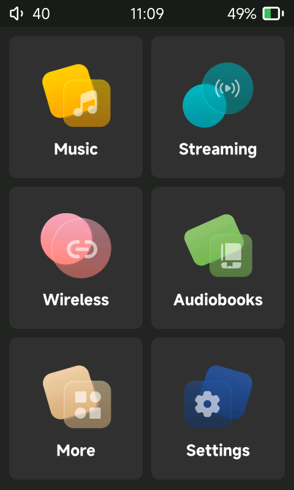
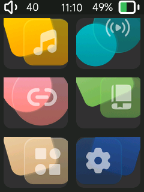

# UI review and visual evidence

## Provenance of the evidence

One genuine screenshot was captured in this session:

* Device profile: **HiBy R1 main screen** (the 480×800 frame actually captured).
* Environment: **host SDL simulator**, not a physical device.
* Binary: the prebuilt `sonix_player_host` found in the local working tree at
  `/home/diogo/Downloads/Hiby/sonix-player/sonix-player/sonix_player_host`
  (aarch64 ELF, built 2026-11-18). Its exact source commit is **not proven**.
* Command (abbreviated): bubblewrap mapping `/tmp/sonix-shot/sdcard` to
  `/mnt/sd_0`, `SDL_VIDEODRIVER=dummy SDL_AUDIODRIVER=dummy SONIX_PANEL=480x800
  SONIX_CONFIG=<temp config> ./sonix_player_host`, then `touch /tmp/sonix/shot`,
  which triggers the application's own screenshot path (`main.c:76-86`,
  `screenshot.c:19,99-128`) and writes a PNG from the SDL renderer
  (`main.c:1299-1319`).
* Result: `docs/QA/screenshots/r1/main.png`, 44,443 bytes, 480×800. The image was
  opened and inspected: it shows the main tile grid (music, streaming, wireless,
  audiobooks, more, settings) with status bar.

This is emulator/simulator evidence. It is **not** physical hardware validation
and **not** firmware screenshot evidence.

## Screenshot

**Figure 1.** HiBy R1 main screen, host SDL simulator, 480×800. Captured from the
project's own screenshot path using a prebuilt simulator binary; exact commit
unknown. Demonstrates the six-tile home screen and status bar. No claim is made
about device rendering.

## Additional captures after the V1 port

After the shared board profile was implemented and the host binary rebuilt with
locally built audio libraries, genuine screenshots were captured for all three
devices. Each run used the device's own `system-info.json` under a per-device
working directory and the application's own `/tmp/sonix/shot` trigger.

**Figure 2.** HiBy R3 Pro II, 480×720. Confirms the shorter panel retains the
six-tile layout and status bar.

**Figure 3.** TempoTec V1, 240×320. The compact profile is visible: two columns
of tiles, 6 px padding, 24 px status bar and compact font rasters. This is a
genuine compact layout, not a scaled 480-pixel frame. The smaller labels are a
remaining readability limitation.

## Limitations

* All three images are **host simulator** renders, not physical-device evidence.
* The first R1 screenshot in this review came from an older prebuilt binary with
  unproven commit; the updated `r1/main.png` came from the freshly built
  simulator in this worktree.
* Before/after comparisons are not available (no reproducible prior build under
  identical conditions).
* V1 label legibility at 240×320 needs device-level review.

## Assessment

The one captured image is an authentic rendering of the application and confirms
that the simulator screenshot path works. It is insufficient to support any
claim about R3 Pro II or V1 UI quality, readability, touch targets or
device-specific adaptation. Those require either a working per-device simulator
target or physical hardware.
