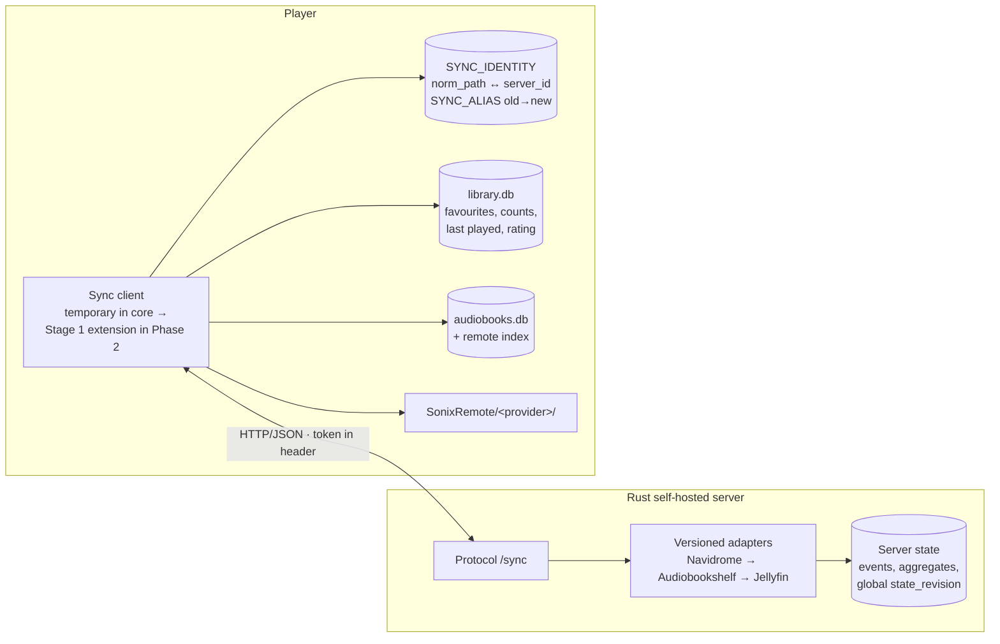

# Proposal: self-hosted sync as a plugin extension (issue #80)

**Status:** design proposal for public discussion. It contains no code, does not change firmware, and can be read without acceptance of any open PR. Phase 2 depends on Stage 1 of PR #30 and Phase 3 on Stage 3 (whose catalog updates Stage 2 loadable extensions only — see section 6); Phase 1 does not depend on the Stage 1 runtime. **This PR requests approval only of the design and the Phase 1 plan; the firmware changes arrive in a separate PR with its own review.**

**Related:** issue #80 (request), the maintainer's comment on that issue, PR #30 (`docs/architecture/PLUGIN_ARCHITECTURE.md`) and PR #28 (where the maintainer asked for a plugin system instead of more core features).

---

## 1. Intent and motivation

Issue #80 asks for a small, self-hosted server and a protocol that lets the player download files and report back playback state: play count, last playback, audiobook progress and rating. The longer-term motivation is smart playlists and adapters for Navidrome, Audiobookshelf and Jellyfin. The reporter preferred a Rust server with a plugin interface.

The maintainer framed it as "a very cool evolution based on the planned plugin system", noting that the player already has DLNA but without certainty about what it can do. The reporter then identified the real blockers: a stable identity for a file across the player and server databases, detection of changes made outside the player (adb, manual copies), local copies versus a remote source, and a possible physical split between `data/local` and `data/remote`. His conclusion was that sync must happen on the player, over the network.

This proposal accepts that framing and resolves it within the PR #30 architecture. Phase 1 is a temporary core-hosted implementation with a small, explicit set of APIs (section 5.7) and a planned removal in Phase 2.

## 2. Decision made

**Service adapters live in the server, not on the player.** The player speaks only a generic sync protocol; Navidrome, Audiobookshelf, Jellyfin and others are plugins *of the Rust server*. This was chosen between:

- **A (chosen) — adapters in the server:** the player runs only a sync client as a Stage 1 extension. Provider changes never require a reflash; the firmware stays small. Cost: a self-hosted server is required.
- **B — adapters on the player:** each service would be a Lua or native Stage 1 extension of PR #30. More autonomous, but Lua's CPU/memory budget on the X1600 has not been measured and every provider change would require a firmware update.
- **C — hybrid:** a common protocol with server adapters plus a minimal local adapter to start without a server. More surface to maintain, no clear gain for the first use case.

Server adapters are versioned Rust trait objects compiled into the server binary. Updating them is ordinary self-hosted software maintenance and never touches the player image. The player has no provider-specific behaviour: the `provider` field and the path segment are opaque server-supplied labels used only for namespacing.

## 3. Goals, non-goals, anti-goals

**Goals**

- Sync files and state (favourites, play counts, last playback, audiobook progress, rating) with a self-hosted server. In v1, rating is device-to-server only; the other fields have inbound paths (section 5.5).
- Keep service adapters out of the firmware image.
- Preserve the local library and existing habits, including copying files via adb.
- Reuse the existing HTTP transport and integrity checks where appropriate.

**Non-goals**

- Reimplement an iTunes-style manager; the server is a sync target, not the sole owner of the files.
- Require a server for users who do not want one: local mode stays intact and is the default.
- Sync the full `PLAY_HISTORY` table — it stays local; only last playback and counts are synced.
- Edit remote files on the player in the first version.
- Touch the bootloader or the OTA chain.

**Anti-goals**

- Losing favourites or play counts after a rescan or a folder reorganisation.
- A sync plugin that blocks playback or updates.
- Forcing the user to stop copying files manually.
- Introducing a new file format for the local library.

## 4. Constraints in the current system

- `library.c` keys user state by `path`: `FAVOURITES(path PRIMARY KEY)`, `PLAY_COUNTS(path PRIMARY KEY)`, `PLAY_HISTORY(path)`, `PLAYBACK_QUEUE(idx PRIMARY KEY, path, slot)`. `PLAYBACK_STATE(id PRIMARY KEY, path, position, updated_at)` holds **one row** (`id=0`); `MEDIA_TABLE` has key `(id, path, cue_id)`. `library_note_play()` writes to `PLAY_COUNTS` only if the path exists in `MEDIA_TABLE`.
- Stock firmware has no API to read/write an absolute `PLAY_COUNTS` value: `library_note_play()` only increments. `sqlite3 *db` and `db_lock` are static in `library.c`; `audiobookdb.c` has its own. Both use `journal_mode=TRUNCATE` with no `busy_timeout`, so a second connection is unsafe.
- **There is no rating store, getter, setter or UI anywhere in `src/`.** Syncing rating means creating them.
- Audiobook progress lives in a separate database: `AUDIOBOOK_TABLE(path PRIMARY KEY, last_played, resume_file, resume_pos, ...)` and `AUDIOBOOK_FINISHED(path PRIMARY KEY, finished_at)`, with `AUDIOBOOK_PARTS(path PRIMARY KEY, book, idx, title)`. Existing setters stamp `time(NULL)`; async position writes use `position_seq`/`position_written`. The scan wipes and refills the tables and is hard-wired to `<sd_root>/Audiobooks`; module state is file-static.
- **The scanner skips names beginning with `.`** in both the full scan and Detect changes, so a `.sonix/remote/` tree would be invisible to `MEDIA_TABLE`.
- Normalisation is inconsistent: `MEDIA_TABLE` uses `COLLATE NOCASE`, while `FAVOURITES`, `PLAY_COUNTS` and `AUDIOBOOK_TABLE` are binary keys; paths embed the mount prefix and `MOUNT_SERIAL` changes on every mount.
- `SonixLink` inspires the HTTP/JSON transport (port 7800, `/api/state`, `/api/command`). `queue_revision` is compared to drop stale commands and `favourites_revision` is compared on the player to invalidate cached favourites; the others mainly refresh phone-side copies. It has no dedupe or conflict resolution.
- The buffered HTTP path follows redirects and allows http↔https hops; on 302/303 a POST becomes a GET with no body (`http_request()`). `http_get[_ex]()` truncates the body at `limit`. `http_stream_open()` has its own redirect loop, sends `Icy-MetaData: 1` and accepts no extra headers, so it cannot carry `Authorization`.
- `dlna_owns_path()` is a prefix test on `.local/dlna-cache`; playback ownership is the separate `dlna_owns_playback()`.
- `config.c` has no mutex: `config_set()` mutates a shared table and `config_save()` writes a shared temp file and renames.
- `tls.c` creates one `shared_ctx` on first use and `load_ca()` returns at the first successful source, so a configured bundle displaces the system anchors; hostname verification (`SSL_set1_host`) already exists.
- There is no shared write lock across the scans, DLNA and Wi-Fi transfer. `wifitransfer_running()` means the daemon exists and caches its state for up to 1 s.
- `tools/validate_upt.py` is not in the main tree; in the integration branches it uses **MD5**, not SHA-256. It is not a cryptographic guarantee.
- PR #30 is a proposal: there is no extension manager, manifest loader or service tick in the tree yet.

## 5. Architecture

### 5.1 Two plugin layers



The flow of a local state is: `FAVOURITES.path → norm_path → SYNC_IDENTITY.server_id → event (uuid, seq) → POST /sync/state → server → adapter`. The reverse direction writes through exported player APIs.

- **Rust server.** Exposes an open, documented HTTP/JSON protocol; each integration is a versioned trait-object adapter. Smart playlists and translation to provider APIs live here.
- **Player.** One sync client: a temporary native entry point in Phase 1, a Stage 1 extension in Phase 2. No provider-specific behaviour.

### 5.2 Player registration (Stage 1 of PR #30, Phase 2)

- Manifest: `SD/.sonix/extensions/sync/manifest.ini` with `id=sync`, `name`, `version`, `api_min=1`, `kind=service`, `capabilities=wifi`, `entry`.
- Hooks: service tick, a Settings row, a "Sync now" tile in More, and an *optional* Now Playing entry.
- Enable/disable list persisted in `device_config.ini`, written only on the UI thread; the worker publishes results by message.
- The extension manager hides it without `wifi` and rejects incompatible `api_min`; a manifest/config validation failure disables only this extension. Stage 1 **loads no code** — manifests only gate and configure a compiled-in extension, and a real load step arrives in PR #30 Stage 2.
- Stage 1 must provide the service tick on a worker thread: `http_get()` blocks.

### 5.3 Track identity

```
SYNC_IDENTITY(
  norm_path TEXT PRIMARY KEY,
  display_path TEXT,
  server_id TEXT UNIQUE,
  fingerprint TEXT,
  hash_alg TEXT,
  file_sha256 TEXT,
  provider TEXT,
  entity_kind TEXT,
  part_of TEXT,
  revision INT,
  updated_at INT
)
SYNC_ALIAS(old_path TEXT PRIMARY KEY, new_path TEXT, done INT)
```

- `norm_path` is relative to the card root, without mount prefix, with ASCII case folding; the card serial is not part of identity. `display_path` keeps the original path.
- `UNIQUE(server_id)` prevents two local paths from pointing at the same server entity.
- `fingerprint` is SHA-256 over the encoded audio frames of the formats listed in §5.7 item 17. The hash skips tags, embedded art and other metadata, so a retag of those formats keeps the same `server_id` and produces no `content_changed` event. `file_sha256` caches SHA-256 over the full bytes for transfer verification; a tag edit updates `file_sha256` and leaves `fingerprint` unchanged. `hash_alg` records the algorithm and variant. A `hash_alg` mismatch is a `hash_migration` state, distinct from `content_changed`: the worker recomputes both hashes from authoritative bytes in the full pass, updates the row in place, keeps the `server_id` binding and revalidates golden vectors. A swap ships C and Rust code, device validation and a rollback path. SHA-256 stays in v1: the firmware carries `src/system/core/sha256.c` and OTA uses it on full images. No measurement shows hashing as the bottleneck. XXH3 stays out of identity: upstream gives no collision guarantee, and a collision would bind the file to the wrong server entity. The partial hash (size + mtime + head/tail) only schedules work. A full pass runs every 24 hours by default, with a 7-day maximum; measurement tunes the interval, not whether it runs. If no measurement happens, 24 hours stands. Store the local inode as a hint for move detection. Identity stays with `server_id` and `fingerprint`: an inode changes on copy or reformat and carries no meaning on another device, so the server keeps no inode relation table. Ratings travel through the sync protocol, not through tags.
- **Rename vs duplicate discriminator:** hash the file still at the old path as well as the new one:
  - **Old path absent or overwritten AND `hash(new_path) == bound_hash` → rename:** migrate the identity row *in place* (`norm_path`, `display_path`) to the new path and treat whatever is now at the old path as a fresh unmanaged file. If the new file's hash does **not** match the bound hash, this is not a rename: leave the identity orphaned and require explicit rebind or revert — never adopt an unrelated adb-copied file as the server entity. Write `SYNC_ALIAS(old → new, done=0)`; physical migration is resumable and marks `done=1` only once `library.db`, both audiobook databases and `SYNC_IDENTITY` are consistent. If the target `norm_path` already has an identity row, report a conflict or merge a stale/orphan row instead of relying on the in-place update succeeding.
  - **Old path present with the bound hash → unmanaged duplicate:** a byte-identical adb copy; no row and no alias, the original path stays authoritative and the copy is never touched.
  While `SYNC_ALIAS.done=0`, outbound events keyed by an old path are resolved through the alias before queueing, or retained in the persistent listener log until `done=1`; the worker never drops them merely because the identity row has moved. Resolution **chases `new_path` until it reaches a live, bound `SYNC_IDENTITY` row whose hash matches the bound value**, detects cycles and stops there, and prefers a live identity row on the path itself over an outgoing alias. On each in-place migration, aliases whose `new_path` is the old path, and chains ending there, are rewritten or removed so the chain always terminates at the current row.
  - A `server_id` is bound only when free. More than one free candidate is reported as a conflict with no automatic choice.
- Server → local: `server_id` resolves to a local path through aliases; with no file, it enters the download queue, which verifies bytes before binding (section 5.5).
- **Audiobooks:** the synced unit is the book; each part has its own identity by `server_id` or content hash, and `idx` is only an ordering hint.
- Unmanaged files are never deleted, moved or overwritten. For a **managed** path whose hash no longer matches its bound `server_id`, the binding and all local state are **retained**, the entity is marked `content_changed` and only reported: no download, no new `server_id`, no overwrite of the user's edit, and **no outbound state events** until the user explicitly rebinds or reverts. Otherwise plays or favourites of the replacement file would corrupt the server entity of the file that is no longer there.
- An identity row whose `norm_path` no longer exists is marked **orphaned**. When a new unbound path appears while an identity is orphaned — for example a folder move combined with a content edit — the sync offers an explicit rebind that migrates the state from the orphan, and suppresses the download until the user decides. It never silently treats the edited file as unmanaged and queues a duplicate.

### 5.4 Files and ownership

- Managed files live in `<card>/SonixRemote/<provider>/...`, a **visible** tree — the scanner ignores names beginning with `.`.
- The tree serves music and audiobooks; a second audiobook index prevents the audiobook scan from wiping local books. Remote-only mode controls the music scan root and which indexes are shown. A **shared exclusion predicate** covers both walkers (full scan and Detect changes) and any path-list insertion. It **fails closed**: the whole `SonixRemote/` tree is excluded from `MEDIA_TABLE` unless an identity row explicitly says `entity_kind=music`; remote music becomes playable only through `library_index_file()` after verification, and must be **re-indexed after every full scan** (`library_scan_start()` begins with `DELETE FROM MEDIA_TABLE`): the worker re-indexes all verified `entity_kind=music` rows from `SYNC_IDENTITY` when the scan completes. Because `library_set_update_listener()` has a single slot already held by the GUI, Phase 1 adds an explicit forward from `gui/library/libraryscan.c` to the sync worker over the existing message channel (or a multi-listener fan-out) — it does not replace the GUI listener. Without this, an ordinary rescan empties remote music and `library_note_play()` stops counting plays for it. Its input is server-supplied `entity_kind` (`music`, `book`, `part`) and `part_of` in `SYNC_IDENTITY`, populated from the manifest, combined with the prefix. This covers cold boot and card swap. It cannot cover the window between `rename()` and identity creation because no identity row exists yet; when identity creation completes, the worker calls `library_index_file()` explicitly so the renamed file becomes playable without waiting for another scan. After a factory reset the identity directory is wiped; the predicate still fails closed and the client follows the no-assertion/seeding rule in section 5.6. A path-only check cannot distinguish a part from remote music — the player's existing book detection is content-based.
- The physical `data/local` vs `data/remote` split requested in the issue is **declined**: `./data` is not restructured; a parallel tree is added and existing local paths stay the same.
- Sync defines its own prefix-based ownership helper for `SonixRemote/`; playback ownership stays in existing player code.
- Write coordination is **best-effort, not mutual exclusion**: the worker waits on `library_scan_running()`, `audiobookdb_scan_running()`, a `dlna_state_t` copied with `dlna_get_state(&s)` while `s.fetching`, and Wi-Fi transfer state, writes to a temporary name and `rename()`s. The window between check and write remains and is documented as residual risk; a shared lock would be a separate core change.

### 5.5 Protocol, ordering and conflicts

SonixLink inspires the transport, not the correctness — it never had dedupe or conflict resolution.

- `GET /sync/manifest?generation=...` → `server_id`, `size`, `mtime`, `audio_hash` (SHA-256 over encoded audio frames, used for identity), `sha256` (SHA-256 over full file bytes, used for transfer verification), `hash_alg` (algorithm and variant tag shared by both hashes), `revision`, `generation`, `entity_kind` (`music`, `book`, `part`), `part_of`, `provider`, a destination path hint, explicit tombstones and capabilities. Identity rows are populated from these fields; they are the source for the fail-closed scan predicate and for the `<provider>` path segment. `etag` is a cache token only. `generation` is a monotonic manifest counter tied to the same instance lifetime as `server_epoch`: without a value the server returns the full manifest; with a value, only changes since then. The endpoint is paginated with per-generation pages and a cursor, because a large library exceeds a single response bound. The request carries the client's known `server_epoch` with `generation`. A regressed or invalid generation, or a generation older than the manifest retention window, returns the same explicit invalid-cursor signal as the state stream and forces a full paginated manifest rebuild; an empty or partial delta is never treated as "no changes". An epoch change restarts `generation` and triggers that rebuild. The local-quarantine counter increments only from a provably complete, non-rebuilt full manifest.
- `GET /sync/file?id=...` → a new API in `http.c` reusing only `conn_open()` and framing, with `extra_headers` (where `Authorization` goes), no redirects, HTTPS only, no ICY; chunks go straight to a temp file, SHA-256 is updated incrementally, a hard size limit is enforced before `rename()`, and a short `Content-Length` is a failure. `get_once()` stays for small JSON only because it buffers and truncates. Verification is against the manifest `sha256` before `rename()` and before creating `SYNC_IDENTITY`. On divergence, refetch the manifest (new generation), re-verify, retry with a bound; past the bound, report "file changed during download" as a conflict. Never bind unverified bytes.
- `GET /sync/state?since=<state_revision>` → changes since the global revision, paginated with an explicit cursor and size limit; `GET /sync/state/full?offset=&limit=` → full snapshot in pages pinned to one `(server_epoch, state_revision)` pair, so pages are consistent even if the server changes while they are read. All three endpoints and the manifest use a size-bounded, truncation-detecting, header-bearing JSON GET, never the silently truncating `get_once()`. **All** `/sync/*` requests, JSON included, use `conn_open()` with the dedicated `SSL_CTX` and `Authorization`. Each state-stream and snapshot entry carries `server_id`, `favourite`, `count`, `last_played` (the server-side `scrobble` timestamp), audiobook resume state and the per-`sync_device_key` contribution breakdown.
- State-stream entries are **absolute aggregate values**, idempotent on replay, carrying origin `uuid`/`seq`/`sync_device_key`. Skipping an echoed event is **conditional on entry kind and on a match with the client's stored applied result**: only plain echoes of accepted events are skipped; `rebase`, `conflict` and `tombstone` entries are never skipped, even when the origin uuid belongs to the client, because they carry the corrected value or the conflict the client must report. Replaying a plain delta is a no-op. **Every** absolute delta — ordinary, server-generated rebase or snapshot — is applied through the same barrier/merge rule: compare with local state, preserve pending outbound intent, and never replace local state in a way that drops queued edits. An offline client therefore does not lose its pending additive counts or explicit-push lists when another device's delta arrives; offline rating edits are queued for the outbound push only (see the rating rule below); **offline position is the v1 exception — reported lost and discarded, not overridden**. For additive fields the snapshot also carries a **per-`sync_device_key` contribution breakdown**, so the client can distinguish the global aggregate from its own value and never asserts someone else's plays. `/sync/state/full` returns its own `state_revision` and `server_epoch`, and the client sets `since = snapshot.state_revision` inside the same barrier that closes/rebases the outbound queue and applies the snapshot.
- `POST /sync/state` → events with `uuid`, `seq`, `sync_device_key` and the originating `lineage_id` persisted with the queue before first send, plus the client's last known `server_epoch`, its `lineage_id`, and a `confirmed` field carrying the uuids/seqs whose conflict or result the client has positively acknowledged. Dedupe entries are purged only on that confirmation. Every ACK, manifest and `/sync/state/full` response carries the server's current `lineage_id` and `instance_id`; the client persists both in `sync_state` before sending the first event of a new lineage.
- If `since` is greater than the server's current revision, or older than the oldest retained delta, the server replies with an explicit "invalid cursor" signal and the client performs a full snapshot rebuild — never "no changes". Delta retention is configurable and documented; `/sync/state/full` is always available.
- `POST /sync/favourites/push` and `POST /sync/rating/push` → explicit promotion with base `rev`, idempotency key and confirmation. Favourites are server-authoritative and have both a pull path (snapshot application) and this push path; rating is **device-to-server only in v1** — there is no rating field in the state stream or snapshot, so a rating changed on the server or another device is not pulled back to the player (section 6). The key includes `sync_device_key` plus a nonce and the cache is scoped by `(server_epoch, sync_device_key)`, so two devices pushing the same entity at the same `rev` and mode cannot collide. Listener records for these server-authoritative fields go to a **push work queue**, not the `uuid`/`seq` queue; they consume no sequence numbers and no watermark. Playlists are deliberately **out of sync scope in v1**: the firmware does have a local playlist store (`playlists.c`, per-playlist tables, `library_playlist_*` APIs, `playlistpage.c`), but syncing it is deferred; no push endpoint is defined for it and it has no snapshot/barrier role.
- The server keeps a global monotonic `state_revision`, a `server_epoch` that changes on server restart or data reset, and an `instance_id` that changes **only** on a data reset; all three are returned in every response and ACK. The revision advances atomically with each accepted event, tombstone or conflict record.

Ordering and idempotency:

- The gates in `POST /sync/state` are **epoch → lineage → dedupe → seq**. The epoch is checked first for the whole batch; on divergence the server returns "resync required". The event's `lineage_id` is checked next, before any dedupe lookup or seq evaluation: a mismatch returns a **no-op ACK carrying the server's current `lineage_id`** and does **not** advance the watermark. The dedupe index is scoped by `(server_epoch, lineage_id)` and reset with them, so uuids from earlier lineages are unknown and never produce false ACKs.
- Within an epoch, dedupe runs before `seq`: any `uuid` in the index returns its stored result as a repeatable ACK, regardless of age — an applied result or a recorded rejection. The window only rejects events never processed, which are never rebased. Entries are purged only after positive client confirmation. Conflict records in the state stream carry the originating `uuid` and `rev`/tombstone detail; a stored rejection is the **full conflict record**, not just a code. The `state_revision` in an ACK is for epoch/cursor validation only, never for advancing `since`.
- `server_epoch` identifies a server instance and changes only on server restart or data reset — **not** on a resync request; otherwise one client's recovery would invalidate every other device and cause a permanent resync storm. A **lineage** is the event sequence under one `sync_device_key`, identified by a server-minted `lineage_id`. Every full resync — epoch divergence, invalid `since`, retention miss, or **local state loss in factory-reset recovery** — starts a new `lineage_id` for that device, and the watermark and dedupe index are scoped to `(server_epoch, lineage_id)` and reset with it; the first event is `seq = 1`. A resync request carries the epoch the client saw; the server **always returns its current epoch and never bumps it**. On any divergence — older client epoch, invalid `since`, retention miss or local state loss in factory-reset recovery — the client adopts the returned epoch and starts a new lineage. An event whose `lineage_id` is not the current lineage for `(server_epoch, sync_device_key)` is **ACKed as a no-op carrying the server's current `lineage_id`** (the rule above), never applied and never advancing the watermark — it is not rejected: an absolute resync supersedes all older-lineage increments, so a late in-flight increment from the previous lineage cannot be counted again. `sync_device_key` survives reinstallation; `seq` is contiguous per lineage, not per session `device_id`. Rules: `seq = watermark + 1` → apply; `seq ≤ watermark` with unknown uuid and matching epoch → reject as unknown event (never rebase); `seq > watermark + 1` → gap signal with prefix resend; `seq ≤ watermark` with unknown uuid and divergent epochs → resync required. The watermark is the highest contiguous applied `seq`.
- Effect and watermark are one transaction; ACK is idempotent. When an event is discarded without being applied — a quarantined, `content_changed` or orphaned entity, a cancelled queue entry, or a play-count event suppressed at enqueue time — the client emits an explicit skip/no-op event carrying its `seq` and `uuid`, so the watermark advances, dedupe stays replayable and a later live event cannot cause a permanent gap. This applies to the normal outbound queue, not only the snapshot barrier.
- On epoch divergence, the client first fetches a fresh `/sync/state/full`, then sends only the **positive diff between its local state and that snapshot** as **absolute-state resync events** with fresh keys and a distinct type — never old increments and never a negative residual, which is report-only. The server tracks each device's committed contribution keyed by `sync_device_key` **per entity**, not by lineage, and persists it across epoch changes and process restarts; a new lineage inherits it, but a **server data reset clears contributions with all other server state** and mints a fresh `instance_id`, forcing every device into a new lineage. The additive value the client asserts is its **own preserved per-device count**, never the global aggregate. On a resync the server applies only a **positive** residual `asserted_device_value − contribution_before` to the aggregate and raises the contribution to the asserted value; a zero or negative residual is not applied at all — the aggregate and the contribution baseline stay unchanged and the client's report is the only effect (see the snapshot rule below). Other devices' commits are preserved, a stale resync cannot clobber them, and increments already applied cannot be counted twice. Where the provider API allows, it reconciles the **positive** residual `scrobble`; otherwise it reports divergence. Normal increments are never replayed across an epoch boundary.
- Snapshot application is a **barrier held as one critical section** under the same lock used by the change listener and state reads: from capturing `local_before` at the instant the queue is closed, through computing `diff = local_before − snapshot`, through applying the snapshot. No play or favourite may land between those steps. The snapshot is applied only to server-authoritative fields (favourites, `last_played` and audiobook resume position; playlists are out of v1 scope); additive local values such as play counts are **not overwritten** by the aggregate. `last_played` arrives in the `last_played` field of each state entry and is merged as `max(local_last_played, snapshot.last_played)`: a local play seen offline can raise it, but a snapshot never lowers it. From the captured diff, re-send only the **positive** play-count delta as **absolute-state resync events asserting this device's own value**, with the residual reconciliation described above — ordinary increments are never replayed across a snapshot and rolled-back counts are reported, not asserted. `content_changed`, orphaned and quarantined rows are filtered out of `local_before`, the diff and the assertions: they emit report/skip only, and their contributions are left untouched until an explicit rebind or revert. For epoch/snapshot **residual** assertions, the client asserts only when its local inventory is complete and the per-device breakdown supplies `contribution_before`; without either it makes no assertion and reports the discrepancy. This gate does **not** apply to registration assertions after a server data reset (section 5.6): those are absolute-value assertions with `contribution_before` treated as zero and are mandatory even when the breakdown is absent. An entity present in the snapshot but absent locally produces **no assertion** (the server keeps that contribution); it is re-downloaded and seeded from the per-device breakdown. A rolled-back local count — whether the entity is absent locally or still present — is a **negative residual: report-only**. The server never applies it: it neither subtracts credited plays from the global aggregate nor lowers the contribution baseline (lowering it would let the same plays be credited again). Audiobook resume is re-read with an explicit "offline position lost" report and no override; favourites have both snapshot application and their `push` path, while rating has **only** the outbound `push` path in v1 (no rating field is applied from the snapshot). The barrier never auto-promotes server-authoritative fields.
- **Stale `rev` rejection:** commit a conflict record, advance that seq's watermark and keep the stream moving. The rebase is a **server-generated state delta** with a new `state_revision`, read via `GET /sync/state?since` — never a new client `seq`.
- **Tombstone rejection:** also records a conflict and advances the watermark, but **no rebase**; the client reports and discards only after confirmation. A tombstone puts the entity in **quarantine, never deletion**; confirmation only discards the rejected event and acknowledges the conflict. No restore exists in v1 — server tombstones are final. A quarantined entity is **excluded from outbound event generation** and stays on the device until the user deletes it locally, so the conflict is terminal.
- **Playcounts:** normal wire events are increments because Subsonic only offers `scrobble`. The absolute getter/setter materialises the local aggregate; the sole network exception is the absolute-state resync event above. `last_played` travels in the same state entries as the count and is merged as the max of local and server timestamps; the count itself is never overwritten by the server value.
- **Rating (device-to-server only in v1):** the device clock is never authoritative; offline edits are queued for the push endpoint and its ACK may carry `server_time` for the device's own edit. There is no inbound rating field: a rating changed on the server or another device is never applied to the player, so this part of issue #80's sync-back requirement is **unmet in v1**. If rating remains in scope, Phase 1 creates the missing store and UI, and rating has an explicit override push with base `rev` and a fresh idempotency key, mirroring favourites. Two-way rating would need a later revision adding a state-stream field and the same base-`rev` merge used for favourites.
- **Audiobook resume position:** server-authoritative; offline position is reported lost and discarded, with no override in v1. Music `PLAYBACK_STATE` is a single `id=0` row and is **not synced in v1**.
- **Favourites:** the server is authoritative; local promotion requires a `push` with base `rev` and an explicit merge/replace choice. Only a **committed** push is cached by its idempotency key; a rejected push is not terminal, and resolution uses a fresh key derived from `rev` + chosen mode + `sync_device_key` + nonce.
- **Tombstones:** explicit, with `rev`; authenticity comes from the TLS-authenticated server, with no second anchor or separate signature. Two distinct authorities exist. **Server-authorised quarantine requires an explicit tombstone and is final.** Independently, **local quarantine** may follow user confirmation or N consecutive **full** (cursorless, completely fetched) manifests without the file. A `?generation=` delta response neither increments nor resets that counter, because an unchanged file is absent from a delta by design; "absent" means absent from a verified full inventory. A file merely absent from one manifest is only `unverified`, never quarantined, and a rebind path exists if it reappears. Network errors and partial manifests never delete or quarantine anything. Both paths are in scope for this design.
- **Provider delivery:** delivery state is persisted per delta; where the provider API allows reading a count, the server applies the residual delta after a lost ACK; otherwise it reports divergence.

### 5.6 Security and credentials

- The token is sent in `Authorization` on **all** `/sync/*` requests, never in URLs, logs or diagnostics; no redirects and HTTPS-only apply to JSON and downloads alike, with the same dedicated `SSL_CTX`.
- The sync client has its **own `SSL_CTX`** with the server CA (or certificate/hostname pin), instead of loading it into the global `shared_ctx`. The private CA therefore never becomes trusted for OTA or any other firmware HTTPS; system anchors stay intact. A fresh context does **not** inherit verification: `tls_ctx_new_with_ca()` must set `SSL_VERIFY_PEER` and the TLS 1.2 minimum itself, and `tls_client_with_ctx()` must repeat SNI plus `SSL_set1_host`. Verification is explicitly applied to this context, not assumed.
- Checksums detect corruption and version skew. TLS authenticates the server and the manifest, so a checksum is not a trust anchor in the sync protocol. The token is the credential; the digest does not carry authority. For Stage 3 code distribution, a signature is required and the hash serves as the digest inside it.
- The token lives in `/usr/data/.sonix/sync.token`, mode `0600`, outside the card and `device_config.ini`, excluded from user settings export. `sync_device_key`, the last seen `instance_id`, the current `lineage_id`, the watermark and the pending `uuid`/`seq` queue live in `/usr/data/.sonix/sync_state`, also outside the card, excluded from settings export and preserved across ordinary reinstallation — a card reformat or an in-memory store would make every post-reboot event arrive with a stale `seq`. `SYNC_IDENTITY`/`SYNC_ALIAS` live in the same `/usr/data/.sonix/` directory. **Firmware fact:** today a factory reset does **not** delete a hidden directory — `factoryreset_run()` unlinks only two configuration files (`device_config.ini` and `ebook_config.ini`, via `OURS[]`), then relies on the stock `recovery_all.sh` `rm -rf /data/*`, which skips dotfiles. The separate `factoryreset_clear_stock_data()` first-start cleanup recurses over `/usr/data` and `/data` (the same directory through a symlink) and removes every non-`KEEP` entry including dot-directories, but only on first start over stock data. A normal reset therefore leaves `/usr/data/.sonix/` intact with the token, queue and identity rows. Phase 1 therefore adds an explicit recursive deletion of `/usr/data/.sonix/` in `factoryreset_run()` before the recovery flag is written: the sync worker is stopped and joined first (it owns handles in that directory), then `library_close()`/`audiobookdb_close()` run, then the delete, so no worker can recreate the token or identity files before reboot. `sync_device_key` is derived from an immutable device identity stored **outside** the wiped directory (alongside the card-side quarantine markers), and that card-side copy is the source of truth copied back into `sync_state` on first run after the reset; the first sync follows the full-resync/new-lineage path with no assertion until identity rebuild completes. A freshly generated key would turn surviving local counts into a positive residual and double-credit every file. A **server data reset** instead clears contributions and mints a fresh `instance_id`, so the first sync after it is registration-only — the server seeds the aggregate from each device's asserted value with **no provider `scrobble` residual**. **Discriminator:** `server_epoch` cannot tell the two recoveries apart because it also changes on an ordinary restart; `instance_id` (returned with every response, ACK, manifest and snapshot, and persisted in `sync_state`) changes **only** on a server data reset. The second signal is a card-side "just restored after factory reset" flag written with the copied-back device identity and cleared only after a successful full sync. When `instance_id` differs from the stored one, **server-data-reset recovery wins** even if the restore flag is also set: a missing breakdown is expected because the reset cleared contributions, so **registration assertions are mandatory** — a distinct absolute-value assertion with `contribution_before` treated as zero, exempt from the §5.5 breakdown gate (which governs only epoch/snapshot residual assertions). As above, the server seeds the aggregate from each device's asserted value with **no provider `scrobble` residual**, and the positive-only rule still applies. When `instance_id` matches and the restore flag is set, **factory-reset recovery** applies: the surviving baseline is expected in the breakdown. The recovery sequence is: re-authenticate if the token was removed → fetch the full manifest → rebuild `SYNC_IDENTITY` → fetch the snapshot → verify that a breakdown entry exists for the presented key. **No additive assertion, positive or negative, is made while that breakdown entry is absent in factory-reset recovery** — "no breakdown for this key" there means no assertion plus a report, never a zero baseline. Once the breakdown is present, section 5.5 permits only a positive residual; a negative one is still report-only. After the wipe, the unmounted card's local databases and `SonixRemote/` files survive with non-zero play counts. Before any assertion, it **rebuilds `SYNC_IDENTITY`** by matching each surviving remote file's `audio_hash` against the full manifest (populating `server_id`, `provider`, `entity_kind`, `part_of`, `file_sha256`) and indexes it with `library_index_file()` only when the manifest entry supplies `sha256`. **Tombstone records do appear in the manifest**, with `server_id` and a tombstone flag but **no `sha256`**; they are skipped by rebuild, binding and download. A file with **no manifest entry at all** is genuinely absent, equally unverifiable, is never bound or downloaded and stays `unverified`/unmanaged pending an explicit rebind. Tombstone/quarantine markers are persisted on the card (in the surviving local databases or a card-side file) so a factory reset cannot resurrect a terminal conflict. Until the rebuild completes the client makes **no additive assertion**, seeding from the snapshot's per-device breakdown, so the residual is never computed against a zero baseline. Known limitation: root/adb root on the device can still read either file; no hardware keystore is assumed.
- On `401`/revoked token the client signals "re-authenticate", stops the retry loop and never deletes local files. Rotation and revocation are **not yet specified** and are not presented as implemented.

### 5.7 Explicit Phase 1 core APIs

Phase 1 does not need the Stage 1 runtime, but it is a temporary implementation in firmware, with device testing. The minimum set:

1. `library_play_count(path)` and `library_play_count_set(path, n, last_played)` in `library.c`, under `db_lock`; no second connection and no transaction held across network I/O.
2. Setters in `audiobookdb.c` for `last_played`, `finished_at`, `resume_file`, `resume_pos` and part mapping, integrated with `position_seq`/`position_written`: drain or invalidate pending checkpoints before applying a server value, and do not apply while the book is playing.
3. **If rating stays in scope:** a rating store with getter/setter under `db_lock` and a UI affordance. If it is descoped, issue #80's rating requirement is explicitly unmet in v1 and this line leaves the list.
4. `SYNC_IDENTITY`/`SYNC_ALIAS` in their own DB with a mutex and resumable migration; `sync_device_key`, `lineage_id`, watermark, last seen `instance_id` and pending queue persisted in `/usr/data/.sonix/sync_state`, excluded from settings export and preserved across reinstallation. **Lock order:** the identity mutex is a leaf — never take `library.c`'s `db_lock` or `audiobookdb.c`'s lock while holding it. The fail-closed scan predicate reads a worker-published in-memory snapshot of bound music paths, refreshed outside `db_lock`, so a scan holding `db_lock` never waits on the identity mutex and the two threads cannot deadlock.
5. Config written only on the UI thread; the worker publishes results by message.
6. A single scan-root accessor used by both `library_scan_start()` call sites (`gui/library/libraryscan.c`, `gui/wireless/sonixlink.c`) and by every `library_card_returned()` caller (`libraryscan.c`, `wifitransfer.c`, `usb.c`, `system.c`), so Detect changes cannot reset the root to the raw card root. The second audiobook index keeps its own root; `audiobookdb.c` is refactored to per-instance state/handles, and **every** path-taking per-index `audiobookdb_*` API takes that handle — position, bookmarks, `book_info`, `touch`, `mark_finished`/`is_finished`, `is_folder_book`, `parts_for_each`, `book_for_file`, `scan_start(root)` and the per-index scan predicates — with no illustrative list implying any of them can remain on file-static state. Callers include `system/playback/audiobook.c`, `gui/library/audiobooks.c`, `gui/library/audiobookextras.c` (bookmark flows from Now Playing), and the lifecycle/`scan_running` sites in `main.c`, `system/device/system.c`, `system/device/usb.c`, `system/device/power.c` and `factoryreset.c`. **Handle discipline:** all per-index operations — including the pathless ones `count`, `index_open`, `revision`, `needs_rescan`, `names_for_each`, `bookmarked_books_for_each` and `bookmark_remove(id)` — take an explicit index handle or selector, and the audiobooks GUI selects an index explicitly. The named exceptions are global lifecycle calls (`open`, `close`, `reopen_if_replaced`), which create or destroy index state, and the aggregate scan queries (`scan_running`, `scan_found`, `scan_stop`), which cover both indexes and take no selector. IDs are scoped per index so bookmarks cannot collide. A shared exclusion predicate covers both walkers and any path-list insertion so remote audiobook parts never enter `MEDIA_TABLE`.
7. Reuse the **existing** `wifitransfer_running()` and `audiobookdb_scan_running()` predicates in the best-effort coordination set; no new API is needed for them.
8. A streaming download API with `extra_headers`, no ICY, size limits and SHA-256, built on the ctx-aware `conn_open()` variant. Sync does **not** use `http_request()`; any no-redirect/HTTPS-only flag added there would apply only to non-sync callers and must not put the private CA into the global context.
9. Expose `tls_ctx_t`, `tls_ctx_new_with_ca()` and `tls_client_with_ctx()` in `tls.h` (optional reload) and a ctx-aware `conn_open()` variant. The new context sets `SSL_VERIFY_PEER` and the TLS 1.2 minimum; `tls_client_with_ctx()` repeats SNI and `SSL_set1_host`. **All** `/sync/*` requests, JSON included, use that variant with `Authorization`; otherwise the private CA ends up in the global context or the control plane fails verification.
10. A temporary native entry point (button + worker).
11. `library_index_file()` / `library_index_paths()`, non-destructive and under `db_lock`, or a path-list mode for `SCAN_UPDATE`, to index downloaded files before they are playable. `library_scan_start()` is a full scan that begins with `DELETE FROM MEDIA_TABLE` and **must never** be used for downloads.
12. A play/favourite change listener (or small persistent log) covering **every** `FAVOURITES` mutation — `library_fav_toggle()`, `library_fav_add_many()`, `library_fav_remove_many()`, `library_forget_under()` and `library_forget_deleted()` — as well as `library_note_play()`. `library_forget_deleted()` removes both `FAVOURITES` and `PLAY_COUNTS` rows: favourites go to the push work queue; the play-count removal is **local-only** — the server aggregate is never decremented, and the worker emits only a skip/no-op seq for any queued increment of that entity. There is no `FAVOURITES` write in the Detect-changes walker. Play-count events are drained into the `uuid`/`seq` queue; listener records for favourites/rating go to the push queue. The listener is invoked only after `db_lock` is released. For the reverse direction, a single `library_fav_set(path, name, artist, wanted)` takes `db_lock` **once** and does SELECT + INSERT/DELETE through an internal `_locked` helper, used by both `library_fav_toggle()` and the worker — composing `library_fav_contains()` with `library_fav_toggle()` under `db_lock` would deadlock (non-recursive mutex) or race.
13. A size-bounded, truncation-detecting JSON GET with headers and the dedicated TLS context for `/sync/state?since`, `/sync/state/full` and `/sync/manifest`, with cursor pagination for `since`.
13b. A POST/JSON request API on the same ctx-aware `conn_open()` with `extra_headers` (where `Authorization` goes), a bounded request body, no redirects, HTTPS-only and a size-bounded, truncation-detecting response. This carries `POST /sync/state`, its `confirmed` field, and the `favourites`/`rating` push endpoints; `http_request()` is not used by sync.
14. Full-state read APIs under `db_lock` — `library_state_snapshot()` and its `audiobookdb.c` equivalent — for the initial inventory, the snapshot-diff barrier and rename/duplicate checks. Without them the worker cannot build its pending set without an unsafe second connection.
15. A scan-completion notification to the sync worker (forward from `libraryscan.c` over the existing message channel, or a multi-listener fan-out) so verified remote music is re-indexed after every full scan without displacing the GUI's `LIBRARY_UPDATE_SCANNED` listener.
17. Audio-frame extraction for the identity hash. The firmware exposes MP4 frame boundaries and art offsets through `mp4_read_audio_frame()`, `mp4_audio_frame_count()`, `mp4_max_frame_size()` and `mp4_cover_art()` in `src/system/decode/mp4.h`; Phase 1 reuses those APIs for M4A/M4B. `decode.c` walks raw AAC ADTS frames for the decoder but exposes no frame ranges to callers. MP3 has no public frame enumerator: `mp3_scan()` builds a sparse seek index roughly every 2 seconds. Phase 1 adds MP3 frame enumeration that skips ID3v1/v2, APE tags and Xing/Info headers and walks VBR frames. Other formats stay unmanaged until their byte ranges are defined. The Rust server computes the same `audio_hash`. Both sides pin SHA-256, the same frame ranges and hex encoding. Golden vectors cover C/Rust agreement **and retag equivalence** (same frames, different tags or art) for each supported format; agreement forms a Phase 1 acceptance gate. The periodic full pass uses this API.
18. Recursive deletion of `/usr/data/.sonix/` in `factoryreset_run()` before the recovery flag is written: stop and join the sync worker, close `library.c`/`audiobookdb.c`, then delete, so nothing recreates files before reboot. Hidden directories currently survive a reset. The stable device identity used for contribution tracking lives in a card-side file beside the quarantine markers, is the source of truth copied back into `sync_state` after the reset, and survives the wipe; the same card-side file carries the "just restored after factory reset" flag. Recovery compares the persisted `instance_id` with the server's: a changed `instance_id` means server data reset and takes precedence even when the restore flag is set; an unchanged `instance_id` with the flag set means factory-reset recovery.

Stage 1 requirements, not Phase 1: manifest loader, extension manager, capability gating, enable/disable list, failure containment and a worker-thread service tick.

## 6. Phases

- **Phase 0 — decision.** This document: server-side adapters, identity by hash, visible `SonixRemote/`, events with `uuid` + `sync_device_key` + global `state_revision`, and the decisions in section 8.
- **Phase 1 — temporary core-hosted core, no Stage 1 runtime.** Firmware PR: the APIs in section 5.7, the client-side protocol handling, resumable migration, second audiobook index, rating store (if in scope) and manual entry point. **Separate named deliverable in the server repository:** the Rust server, the protocol implementation and the first Navidrome adapter; it is a prerequisite for Phase 1 device validation and is owned outside the firmware PR. A host build helps, but this touches firmware and needs device testing; this document produces no image. Coverage of the **four** state fields requested in issue #80 with the first adapter: **play count** — demonstrable via Subsonic `scrobble`; **last playback** — derived from the server-side `scrobble` timestamp and merged as `max(local, server)`, not written back to the provider; **rating** — demonstrable only if it remains in scope, and then as a device-to-server push only: there is no inbound rating path in v1, so issue #80's rating sync-back is unmet; **audiobook progress** — waits for the Audiobookshelf adapter and is **explicitly unmet in v1 with Navidrome**. Separately, the adapter also demonstrates favourites via `star`/`unstar`; favourites is not one of the four fields requested in the issue.
- **Phase 2 — Stage 1 extension.** The temporary client is replaced by an extension with manifest, service tick and config; background sync with CPU/memory budget and retry; device testing. **Depends on Stage 1 of PR #30 being implemented and accepted.** Phase 1 proceeds independently of that decision. If Stage 1 is eventually rejected, the revision for Phase 2 must include an explicit removal or replacement plan for the Phase 1 core additions before further firmware work.
- **Phase 3 — distribution.** A Stage 3 catalog with a real signature over `hash_alg`, the digest value and length, and the code bytes together. A bare hash does not authenticate code. Per PR #30, catalog updates cover **Stage 2 loadable extensions only**: server adapters keep updating as ordinary self-hosted software, while the player's sync client can be updated from the catalog **only if Phase 3 first moves it from the compiled-in Stage 1 service of Phase 2 to a Stage 2 runtime extension** — that migration is an explicit Phase 3 prerequisite. If it is not done, changing the sync client requires a firmware rebuild and reflash, not a catalog update. The MD5 `validate_upt.py` chain is not reused as an integrity guarantee.

## 7. Risks and mitigations

- **Hashing on a slow card:** the partial hash only schedules work. A full pass every 24 hours, bounded at 7 days, closes the missed-change window; measurement tunes that interval. XXH3 and BLAKE3 have no in-tree code; adding either means new vendored source, build objects and tests. Measure SHA-256 on hardware before swapping the algorithm.
- **Card writes:** best-effort coordination and atomic `rename()`; the window between check and write remains, and a shared lock would be a separate core change.
- **New server to maintain:** short, public protocol spec; dedupe retention and the never-processed event window need sizing and documentation.
- **Non-idempotent provider writes:** delivery state is persisted, counts are read where possible and divergence is reported where not.
- **Rating:** a new store, API and UI; the largest single Phase 1 item and conditionally descopable. Even when kept it is device-to-server only in v1, so issue #80's rating sync-back requirement is not met in v1.
- **Resource limits:** native client with backlog and response-size limits; no framebuffer or MTD access.
- **Platforms:** the client is offered only with the `wifi` capability.

## 8. Decisions

**Author of the proposal:**

1. **Stage 1 is retained for Phase 2.** No Stage 1 runtime hooks are put in the core as a shortcut, except the explicitly proposed temporary native entry point of Phase 1, subject to maintainer approval. Phase 1 is temporary, with planned removal in Phase 2.
2. **First adapter: Navidrome.** Subsonic has `scrobble`, `setRating` and `star`/`unstar`; it has no absolute play-count write, hence increment events. `setRating` is a device-to-server write only in v1; no provider rating is pulled back. Audiobookshelf and Jellyfin follow once their write paths are mapped; anything an adapter cannot write is reported as unsupported, never faked.

**My calls, so a builder can plan:**

- Server adapters as versioned Rust trait objects compiled into the binary.
- Normalised `norm_path`, `UNIQUE(server_id)`, audio-frame SHA-256 for identity, full-file SHA-256 for transfer checks, inode only as a local move hint, aliases with in-place rename, byte-identical duplicates unmanaged, `content_changed` reporting with no automatic rebound.
- Full SHA-256 for binding and downloads, with `hash_alg` pinned in the identity row and manifest; partial hash only as a scheduler with a 24-hour full pass capped at 7 days; `hash_alg` migration as a distinct state with golden vectors and a rollback path; BLAKE3 as a future swap after measurement, XXH3 out of identity.
- Gates `epoch → lineage → dedupe → seq`, dedupe scoped by `(server_epoch, lineage_id)` with repeatable ACKs, persistent `sync_device_key` for the watermark, **positive-only** absolute-state events at epoch/snapshot boundaries (negative residuals are report-only), server-generated rebase deltas, global `state_revision` and `server_epoch` with snapshot rebuild, and an `instance_id` that alone identifies a server data reset.
- Rating is device-to-server only in v1; offline rating stamped with `server_time` on its push ACK; offline position reported lost; device clock never authoritative.
- Explicit tombstones with `rev`, TLS authenticity, quarantine with no outbound events, provider delivery state.
- Token in `/usr/data/.sonix/sync.token` (0600), `Authorization`, no redirects, dedicated `SSL_CTX` isolated from OTA; 401 stops the loop and asks for re-authentication.
- Visible `SonixRemote/` tree, second audiobook index, conditional rating store, temporary native entry point and non-destructive indexing in Phase 1.
