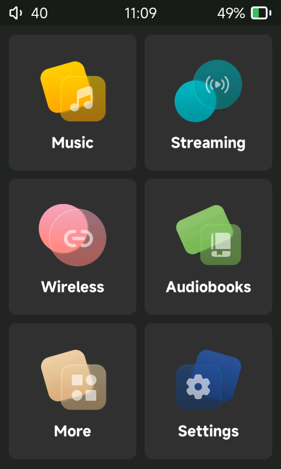
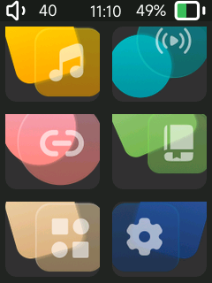

# Sonix Player — three-device integration engineering report

**Reviewed implementation commit:** see `docs/reports/REVIEWED_COMMIT.txt` (a
later commit updates this record without changing implementation content).
**Branch:** `integration/three-device`. **Report date:** 2026-11-22.

> Scope note: this report describes a working three-device codebase. It does
> **not** claim physical-device validation or flashability. Two images pass
> structural validation; the R3 Pro II target is blocked by a mandatory metadata
> check. No image is safe to flash on this evidence.

---

## 1. Executive summary

### Achieved

* Preserved the original working tree; isolated all work in `integration/three-device`.
* Investigated upstream `Tartarus6` (`5d8bb17`), V1 fork `mr-f0xx`
  (`e962720`) and the local tree (`7aa3637f7`, 16 local commits).
* **Implemented V1 support in the shared codebase**: a third row in the runtime
  model table, a shared board profile, compact font remapping, the V1 jack-switch
  quirk, and the V1 asset tree and packer imported from the fork.
* Implemented `make r1`, `make r3proii`, `make v1`, `make all`, `make validate`
  with isolated staging, stock-input checksum verification and a mandatory
  validation gate.
* Built `r1.upt` and `v1.upt` successfully; `make r3proii` correctly fails its
  mandatory gate because the available stock R3 Pro II image lacks
  `ota_v0/ota_compatibility.in`.
* Added a three-device CI workflow with least-privilege permissions and no
  publication step.
* Built target and host binaries; captured genuine simulator screenshots at
  480×800, 480×720 and 240×320.
* Kept and extended the independent validator and the independent safety reviews.
* Reviewed all nine prepared local PR features against the V1 fork and merged
  the cleanest one: WavPack DSD / RF64 / Wave64 playback (commit `77862d1e`),
  with its full test suite passing. See `docs/audit/PR_FEATURES_REVIEW.md`.

### Implementation summary (all work in this branch)

| Area | What was implemented | Evidence |
|---|---|---|
| Device support | Three runtime models: R1, R3 Pro II, TempoTec V1 | `sysinfo.c` MODELS, `board_profile.c/h` |
| UI | Compact 240×320 geometry, font remap, 24 px status bar, 6 px padding; HiBy layouts unchanged | `main.c`, `fonts.c`, three screenshots |
| Hardware quirks | V1 inverted headset switch with 120 ms settle/debounce; V1 jack flags | `alsa-controls.c`, `sysinfo.h` |
| Packaging | Per-device isolated staging, stock-input SHA-256 verification, V1 packer imported | root `Makefile`, `tools/prepare_stock_inputs.sh`, `sonix-packer/v1/` |
| Firmware images | `r1.upt` and `v1.upt` built and structurally validated; R3 Pro II image built but rejected by gate | `build/firmware/*/validation.json` |
| Validation | Independent ISO/chunk/identity validator with negative tests | `tools/validate_upt.py`, `docs/QA/validation/` |
| CI | Three-device matrix, least privilege, no publication | `.github/workflows/build-firmware.yml` |
| Audio formats | WavPack DSD native, RF64, Wave64 (PR item-2) | merge `77862d1e`, `tests/run.sh` exit 0 |
| Safety docs | Flashability matrix, flashing safety, recovery guides, OTA migration | `docs/firmware/`, `docs/MIGRATION.md` |
| Reporting | This Markdown report, the PDF, nine-PR review | `docs/reports/`, `docs/audit/PR_FEATURES_REVIEW.md` |

### Not achieved

* No physical device test; no flashing; no recovery test.
* No cryptographic signature or vendor-published checksum for stock inputs.
* No port of every V1-fork-only feature (themes, DLNA, lyrics overlay, listening
  statistics, extra games, tape deck) — these remain fork-only; see §26.
* The `Jepl4r` OTA remote in the HiBy assets is still dead.

### Readiness

The codebase is ready for **review as a three-device implementation with an
R3 Pro II packaging blocker**. It is not ready for release or flashing.

## 2. Scope and objectives

One codebase, three firmware images, correct device identity, independent
packaging, CI, safe OTA architecture, documentation, tests and a prepared (not
published) upstream contribution. Firmware safety takes priority.

## 3. Repositories investigated

| Source | HEAD | Role |
|---|---|---|
| `Tartarus6/sonix-player` | `5d8bb17` | upstream, two HiBy models, official release assets |
| `mr-f0xx/sonix-player-tempotec-v1` | `e962720` | V1-only fork; source of V1 assets, packer and compact UI design |
| local `sonix-player` | `7aa3637f7` | base for integration; 11 modified + 18 untracked entries preserved |

Dead remote `Jepl4r/sonix-player` was confirmed HTTP 404.

## 4. Feature inventory

`docs/audit/FEATURE_INVENTORY.md` records the feature-by-feature status across
all three sources, updated to reflect the V1 port.

## 5. Neutral comparison

`docs/audit/IMPLEMENTATION_COMPARISON.md` compares device profiles, packaging,
OTA, charging, browser state, car mode and validation tooling. Independent
streams supplied assessments; unresolved disagreements are recorded rather than
forced into a false consensus.

## 6. Local improvements absent from the V1 fork

`docs/audit/LOCAL_V1_GAP_ANALYSIS.md` lists eight items with decisions:
stop-after (adopted in the shared base), car mode and AXP charging (kept
per-device), keep-alive (HiBy), browser state (prefer tested V1 design), 48 MiB
gate, HiBy `main.conf` (excluded from V1), and uncommitted date/USB work
(preserved, not integrated).

## 7. Final architecture

One application binary with a runtime `MODELS[]` table keyed by
`system-info.json`; a shared `board_profile` giving compact geometry for the V1
and original geometry for HiBy; per-model asset trees; per-device packers;
isolated build staging; and a mandatory structural validation gate. Source:
`src/system/device/sysinfo.{c,h}`, `src/gui/board_profile.{c,h}`,
`src/gui/fonts/fonts.c`, `src/main.c`, `sonix-packer/`, `Makefile`.

## 8. Technical decisions

D1–D9 in `docs/architecture/DECISIONS.md`, plus the V1-port decision: port the
fork's compact geometry rather than ship a separate binary, because the fork's
own history shows its board profile was originally parameterised for three
boards. HiBy layout constants remain unchanged: the profile only supplies
padding, status-bar height and screen size to `main.c` and the compact font
remap in `fonts.c`.

## 9. Device-specific implementation

* **V1 model row**: 240×320, `v1` update stem, AXP2101 charger, two CS43131s,
  swapped media keys, SGM31324 LED and idle-one headset switch
  (`sysinfo.c:MODELS`).
* **Compact UI**: padding 6, status bar 24; named fonts remapped to compact
  rasters; 240×320 panel floor. The fork's tile radius, screen corner radius and
  header-button helpers are not wired into any layout, so no radius or header
  size claim is made.
* **Hardware quirk**: line-out route accepts the V1's idle-one jack switch
  (`alsa-controls.c`).
* **Packaging**: V1 packer and `assets/V1` imported from `e962720`; stock 1.3
  kernel retained; `verify_upt.sh --stock` plus the new validator.
* **R1/R3 Pro II**: original runtime profile, assets, drivers and kernels retained.

## 10–13. Screenshots and visual evidence

`docs/QA/UI_REVIEW.md` has the full review. All three PNGs are genuine renders
from the freshly built host simulator (`SDL_VIDEODRIVER=dummy`) using each
device's own `system-info.json`, captured through the application's own
`/tmp/sonix/shot` path:

| Figure | Device | Resolution | Evidence |
|---|---|---|---|
| Fig. 1 | HiBy R1 | 480×800 | `docs/QA/screenshots/r1/main.png` |
| Fig. 2 | HiBy R3 Pro II | 480×720 | `docs/QA/screenshots/r3proii/main.png` |
| Fig. 3 | TempoTec V1 | 240×320 | `docs/QA/screenshots/v1/main.png` |

The V1 frame shows a two-column tile layout with compact geometry, not a scaled
480-pixel layout. Simulator evidence only — no physical-device render.

## 14. Firmware build results

| Target | Result | Output | SHA-256 |
|---|---|---|---|
| `make r1` | PASS | `build/firmware/r1/r1.upt` (49,932,288 B) | `7ee51491dfc8edc0f532b859fd6395c3775bdd55947f177cbd2f3d1eff6af4fe` |
| `make v1` | PASS | `build/firmware/v1/v1.upt` (49,539,072 B) | `fb142c3dcdbe02fe65a7763c39152dae465a976ecb9d13e889e21f0cc6ec7ad5` |
| `make r3proii` | **FAIL (gate)** | `build/firmware/r3proii/r3proii.upt` (47,640,576 B) | image exists but is REJECTED |
| `make all` | stops at R3 Pro II gate | — | — |

Both passing images were independently validated structurally. Images are
git-ignored build artefacts and are not part of the branch.

## 15. Package structure and validation

`.upt` is ISO 9660 with OTA metadata, MD5-chained 512 KiB chunks and a per-chunk
manifest. `tools/validate_upt.py` independently parses, reassembles and checks
it, then reads the device identity from the rootfs. The build gate runs it with
the expected device for every target. It proves internal consistency, not
authenticity, kernel model, partition fit or flashability.

## 16. Flashability matrix

Full matrix and evidence: `docs/firmware/FLASHABILITY_MATRIX.md`.

| Device | Classification |
|---|---|
| HiBy R1 | NOT VERIFIED FOR FLASHING |
| HiBy R3 Pro II | **REJECTED** (mandatory compatibility metadata FAIL) |
| TempoTec V1 | NOT VERIFIED FOR FLASHING |

## 17. SHA-256 checksums

Built images: §14. Stock inputs: `docs/firmware/STOCK_SHA256.sha256` —
`r1_original.upt` `0fec88bb…`, `r3proii_original.upt` `6ef350aa…`, V1 split
parts `cae3f02b…` / `9129833f…`, extracted stock `v1_original.upt` `ee35ecbf…`.
Official upstream release assets (not downloaded): `b78cb5a5…` (R1),
`afee07d4…` (R3 Pro II). The official R3 Pro II stock firmware was downloaded
from `oss.hiby.com` during this work and is byte-identical to the local
`r3proii_original.upt` (`6ef350aa…`); it contains no `ota_v0/ota_compatibility.in`.
No newer stock with that marker was found, so the R3 Pro II gate cannot be
satisfied without inventing metadata — which was not done.

## 18. Signature and identity validation

No signature scheme in packers, CI, OTA or images. Integrity is MD5 chains plus
optional GitHub SHA-256. Device identity is the overlay's `system-info.json`;
all three built/staged images were checked against their expected identity.

## 19. Cross-device and corruption tests

Executed: R1 image as R3 Pro II and as V1 → REJECTED; truncation → REJECTED;
byte flip → REJECTED; stock images → REJECTED for missing generated identity.
Reports in `docs/QA/validation/` and `build/firmware/*/validation.json`.

## 20. Recovery and rollback

Source-derived only: HiBy Volume-Up+Power failsafe, `bootmode.sh Recovery`,
stock reflash; V1 stock 1.3 retention. No physical validation.
See `docs/firmware/RECOVERY_GUIDES.md`.

## 21. CI/CD

`.github/workflows/build-firmware.yml`: device matrix, `contents: read`,
separate artifacts, validation reports, no release or flash step. The R3 Pro II
matrix leg fails on the same mandatory gate until a suitable stock input is
provided.

## 22. OTA compatibility and migration

`docs/MIGRATION.md`: selection by device stem from the newest 20 releases;
SHA-256 only when published; dead `Jepl4r` remote remains. Repository/asset/tag
changes break selection. No OTA flow executed.

## 23. Tests

`docs/QA/TEST_REPORT.md`: repository inspection, target build PASS, host build
PASS with locally built audio libraries, three device screenshots PASS, six
validator cases PASS, `make r1`/`make v1` PASS, `make r3proii` correctly FAIL.
Physical testing: none.

## 24. Emulator / physical status

Three simulator resolutions captured. No physical device was connected or
flashed.

## 25. Independent reviews

Archaeology, firmware/safety, UI/build/CI streams; independent QA and firmware
safety reviewers. Findings incorporated: ignored docs fixed, OTA wording
corrected, validator bug fixed, R3 Pro II REJECTED, stock provenance caveats.
After implementation, QA must be re-run; see §26.

## 26. Outstanding issues

* Critical: R3 Pro II stock reference lacks the mandatory compatibility marker;
  need an official newer stock image and updated digest.
* High: no physical validation; no signature/authority model; no vendor checksum.
* Medium: V1-fork-only features (themes, DLNA, lyrics overlay, listening stats,
  tape deck, extra games, some V1-specific LED work) are **not ported**; only the
  device profile, compact UI, jack quirk, assets and packer are. This is a
  deliberate scope boundary, recorded for follow-up, not a claim of completeness.
* Medium: of the nine prepared PR features, only the audio-format PR was merged
  in this pass. Crossfade already exists in the V1 fork; five others are
  feasible but need staged conflict resolution and testing (see
  `docs/audit/PR_FEATURES_REVIEW.md`). Two PRs target the separate Android app.
* Low: dead OTA remote; V1 screenshot labels are smaller/less visible than on
  HiBy panels; exact provenance of local stock images unverified.

## 27. File change inventory

Added: board profile source/header; V1 asset tree and packer (from `e962720`);
root `Makefile`; CI workflow; stock-preparation script; stock checksums;
three screenshots; extra validation reports; provenance note. Modified:
`sysinfo.{c,h}`, `main.c`, `fonts.c`, `alsa-controls.c`, `.gitignore`,
`BUILDING.md` and the audit/report documents. No user work deleted.

## 28. Git evidence

Branch `integration/three-device`; base `7aa3637f7`. Reviewed implementation
SHA in `docs/reports/REVIEWED_COMMIT.txt`. Original tree unchanged.

## 29. Proposed PR

Draft in `docs/reports/PR_BODY.md`; not published. Target `Tartarus6/sonix-player`.

## 30. Licences and provenance

GPL-3.0 unchanged. V1 assets/packer attributed to `mr-f0xx` commit `e962720` in
`docs/audit/PACKER_PROVENANCE.md`. Proprietary `.upt` inputs are git-ignored and
not redistributed.

---

## Final approval gate — summary

**A.** Three-device codebase implemented; R3 Pro II packaging blocked; no flashing.
**B.** Upstream, V1 fork and local sources all represented.
**C.** Eight local improvements assessed in `LOCAL_V1_GAP_ANALYSIS.md`.
**D.** Board profile, V1 assets/packer, build/CI, docs and evidence added; no source deleted.
**E.** V1 compact geometry ported as a runtime profile; disagreements on AXP/car mode remain.
**F.** Branch/SHA above; original tree untouched.
**G.** Three genuine simulator screenshots, embedded in this report and PDF.
**H.** `r1.upt` and `v1.upt` built and structurally validated; R3 Pro II REJECTED; no flash approval.
**I.** Commands/results in `TEST_REPORT.md`; physical testing none.
**J.** Independent reviews incorporated; re-review needed after implementation.
**K.** Markdown + PDF paths; PDF regenerated from this source.
**L.** PR draft prepared; not published.
**M.** V1-only feature set not fully ported; R3 Pro II stock input missing; firmware safety unverified.

**No remote publication and no flashing has been performed.**
